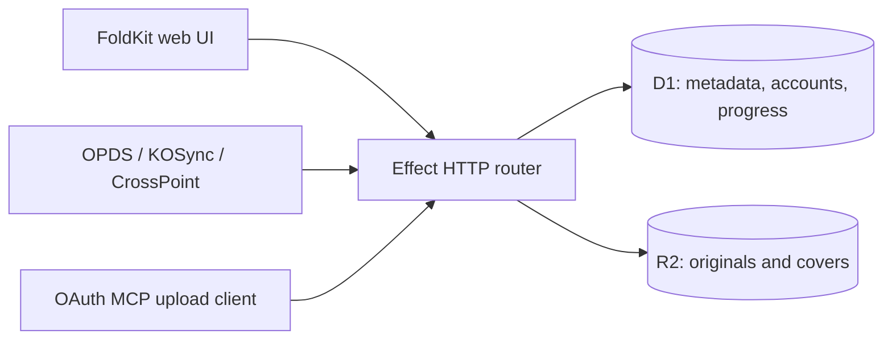

# Folio

A self-hosted ebook library for the browser, KOReader, and CrossPoint readers. Store EPUBs and PDFs in Cloudflare R2, browse and download through OPDS, and sync reading progress and annotations across devices.

Folio runs as one Cloudflare Worker with a FoldKit web UI, an Effect backend, a D1 database, and an R2 archive. The library is private by default: browser administrators sign in by email, and readers use separate device credentials.

## Features

- Upload EPUB/PDF files, extract EPUB metadata and raster covers, edit metadata, search, and download originals.
- OPDS 1.2 (Atom) and OPDS 2.0 (JSON), with authenticated downloads, pagination, search, and HEAD support.
- KOSync reading progress and a subset of CrossPoint's extended progress, bookmark, and clipping APIs.
- Reader account creation, password rotation, and deletion from the web UI.
- OAuth-protected MCP uploads with explicit consent and restricted attachment downloads.
- Versioned infrastructure and database migrations, plus integration tests against local D1/R2.

Reading sync exchanges positions and annotations; it does not synchronize complete library files. See [protocol behavior and limits](docs/protocols.md).

## Architecture



## Local development

Requires **Node.js 24+** and **pnpm 11.20.0**. Optional native KOReader tests also require `luajit`, `lua-socket`, and `lua-cjson` (available through apt on Debian/Ubuntu).

```sh
pnpm install --frozen-lockfile
pnpm typecheck
pnpm build
pnpm test
pnpm dev
```

Open `http://localhost:8787`. Sign in with **admin@example.com**, the development-only administrator configured in `wrangler.jsonc`. Local mode simulates email delivery: retrieve the sign-in link from `http://localhost:8787/api/local/mail` on your trusted development machine. It does not send real email. After signing in, create a reader account under **Readers**.

The development server binds to `0.0.0.0:8787` for reader testing on a trusted LAN. Do not expose local mode or its simulated email outbox to the internet. Local data persists under `.wrangler/state/`; removing it deletes the local library and accounts.

| Command | Purpose |
| --- | --- |
| `pnpm dev` | Build assets, apply local migrations, start Wrangler |
| `pnpm typecheck` | Check application, tests, scripts, and infrastructure |
| `pnpm build` | Build UI and Worker; deployment is a dry run |
| `pnpm test` | Run unit, D1/R2 integration, and reader compatibility tests |
| `pnpm smoke` | Exercise sign-in, upload/download, pagination, deletion, and sign-out against the local server |
| `pnpm iac:auth` | Authenticate the dedicated Alchemy deployment profile |
| `pnpm iac:plan` | Review production infrastructure changes |
| `pnpm iac:deploy` | Apply the reviewed production infrastructure changes |

Rebuild UI assets after UI changes. Wrangler watches server source. Run `pnpm build` before `pnpm test`; integration tests consume the built Worker. Run one test suite at a time because the protocol verifier uses port 8790.

## Deploy your own library

You need a Cloudflare account with Workers, D1, R2, a domain in your account, and access to Cloudflare Email Sending. Email Sending eligibility, billing, and destination verification must be completed in Cloudflare before real sign-in email can work.

```sh
cp .env.example .env
# Edit .env with your zone ID, HTTPS origin, administrator, and sender.
pnpm iac:auth
pnpm build
pnpm iac:plan
# Review the account, domain, storage, email, and migration changes first.
pnpm iac:deploy
```

Alchemy reads `.env`; the file is ignored by Git. All deployment configuration is required, with no personal account or domain defaults:

| Variable | Example | Purpose |
| --- | --- | --- |
| `FOLIO_EMAIL_ZONE_ID` | Your Cloudflare zone ID | Zone containing the sending subdomain |
| `FOLIO_AUTH_ORIGIN` | `https://library.example.com` | Exact HTTPS origin, without a trailing slash |
| `FOLIO_ADMIN_EMAIL` | `you@example.com` | Verified email destination and administrator allowlist |
| `FOLIO_EMAIL_FROM` | `folio@auth.example.com` | Sender on a dedicated sending subdomain in that zone |

The stack provisions a Worker/custom domain, D1 with migrations, an R2 bucket, a stable signing secret, and restricted email resources. It provisions the sender's domain with email previews disabled; use a dedicated subdomain. It does not configure root-domain MX records. Resource names are fixed for a single installation; inspect `alchemy.run.ts` before using an account that already has Folio resources.

The commands select the isolated Alchemy profile `folio-library-prod` and stage `prod`; they do not change your default profile. Keep `.alchemy/` private and back it up securely: `.alchemy/state/Folio/prod` contains ownership state and the generated signing secret. Losing it can prevent safe reconciliation or rotate authentication secrets. Back up D1 and R2 together as well. The zero database UUID in `wrangler.jsonc` is a local placeholder; production is managed by Alchemy.

## Connect a reader

Use your own deployed origin in place of `https://library.example.com`. Sign in to the web UI and create a reader username and a **16–128 character password**. Use the ordinary password on your devices, not an MD5 digest or browser session.

| Client | URL |
| --- | --- |
| KOReader OPDS 1.2 | `https://library.example.com/opds/v1/catalog.xml` |
| OPDS 2.0 | `https://library.example.com/opds/v2/catalog.json` |
| KOSync / CrossPoint reading sync | `https://library.example.com` |

Configure OPDS downloads and reading sync separately. `/opds` and `/opds/` also serve the Atom feed. The website root serves HTML, so entering only the root as an OPDS catalog can produce an empty menu or a silent tap in KOReader. A successful sync message does not establish that the catalog URL is correct.

For LAN testing, replace the origin with your development host's LAN address and port, such as `http://192.168.1.20:8787`. `localhost` on a physical reader refers to the reader itself. Use HTTPS for deployed services because reader protocols transmit password-derived credentials on each request.

See [reader account management](docs/reader-accounts.md), [protocol details](docs/protocols.md), and [verification coverage](docs/verification.md). Physical-reader TLS and firmware position conversion are not covered by the local test harness.

## MCP uploads

The Worker exposes `/mcp` with OAuth discovery, PKCE, dynamic client registration, and explicit consent for `library:upload`. Configure a compatible MCP host with `https://library.example.com/mcp`, use OAuth authentication, and authorize using your allowlisted administrator email. Leave client credentials empty when the host supports dynamic registration.

The `upload_book` tool accepts a host-provided EPUB/PDF file object. Attachment downloads are limited to HTTPS OpenAI attachment hosts, reject redirects, and use the same 16 MiB ingestion limit as browser uploads. Host support for file attachments varies; local tests cover the server flow using synthetic fixtures, not every host's connection UI.

## Security and limitations

- Catalogs, metadata, covers, and downloads require an administrator session or reader credentials. All reader accounts share the same library; their progress is isolated by username.
- Administrator sessions require verified email and an allowlist match. Device credentials and MCP upload tokens do not grant account administration.
- Production signup is closed. `LOCAL_DEV` and `ALLOW_LOCAL_ADMIN` must remain disabled in production.
- Uploads are capped at 16 MiB. EPUB extraction bounds entries, expansion, XML, and raster cover sizes; it rejects DTD/entities. PDF handling checks basic signatures and uses filename metadata.
- R2 and D1 are not a distributed transaction. Interrupted writes can leave pending/deleting rows visible in administration diagnostics; there is no automatic cleanup job.
- No CBZ, ranged downloads, full-text search, full CrossPoint parity, automatic reader digest matching, or hardware-verified position conversion.

Do not include passwords, session cookies, magic links, book files, or private deployment state in public issues. For a private vulnerability report, use the repository's Security tab if private reporting is enabled.

## Third-party code

Pinned test-only upstream sources and their license notices are retained under `tests/vendor/`. KOReader test sources are AGPL-3.0 and are not bundled into the deployed application. See [third-party notices](THIRD_PARTY.md).
